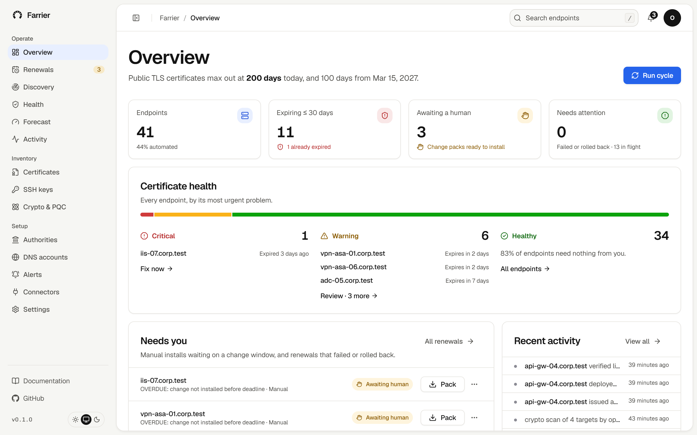

<div align="center">


# Farrier

**Agentless machine identity automation.**

Farrier discovers, manages and secures every machine identity across your infrastructure: TLS certificates,
SSH keys, cryptographic assets and post-quantum (PQC) readiness. Your team oversees; Farrier handles the rest.
No agents. No manual renewals. No missed expirations. Open source, self-hosted, no account.

[](https://github.com/gagankarthik/farrier/actions/workflows/ci.yml)
[](LICENSE)


[Quickstart](web/src/app/docs/quickstart/page.mdx) · [Docs](web/src/app/docs) · [Deploy](web/src/app/docs/deploy/page.mdx) · [Security](web/src/app/docs/security/page.mdx)



</div>

## Why

Public TLS lifetimes are shrinking (CA/B Forum SC-081): **200 days** from 15 March 2026, **100** from 2027,
**47** from 2029. Cloud workloads already auto-renew. The pain is the long tail: load balancers, firewalls,
VPN concentrators, Java keystores and vendor appliances that need a ticket and a change window.

```
$ farrier forecast --certs 1000 --manual 0.4 --minutes 45
from         max life  renew every  per year  per work day  manual h/yr   FTE
2026-03-15       200d         133d      2744          11.0        823.5  0.51
2027-03-15       100d          67d      5448          21.8       1634.2  1.02
2029-03-15        47d          31d     11774          47.1       3532.5  2.21
```

## How it works

```
 scan ──▶ plan ──▶ issue ─────────▶ deploy ──────────────▶ verify
 what's    due date,  ACME DNS-01 on     F5 / FortiGate / PAN-OS /   the handshake shows the new
 served    window,    the device's       keystore / files over SSH   certificate, its chain and
           daily cap  behalf             ─ or ─ change pack + ticket  every name, or roll back
```

The device never talks to a CA. Every automated deploy installs the new certificate under a new name,
switches over and keeps the old one, so a failed check rolls back by itself.

## Features

| | |
|---|---|
| **Appliance connectors** | F5 BIG-IP, FortiGate, Palo Alto PAN-OS, Java keystores, files over SSH. Everything else gets a change pack (PEM, PFX, runbook) and a ticket, and closes itself when the scanner sees the new certificate. |
| **Any CA** | Let's Encrypt, ZeroSSL, Google Trust Services, Buypass, SSL.com, DigiCert, Sectigo over ACME (with External Account Binding), or the built-in private CA. |
| **29 DNS providers** | Cloudflare, Route 53, Azure DNS, Cloud DNS, RFC 2136 and more, several accounts each, with CNAME delegation. Records are verified on every authoritative nameserver and always cleaned up. |
| **Deployment verification** | Done only when the fingerprint, chain, names and every listed VIP check out. |
| **SSH keys** | Scans SSH hosts for host keys, key exchange, ciphers and MACs without logging in. With an access profile it reads `authorized_keys`, flags weak and unknown keys, and removes a key after showing a dry run. |
| **Crypto and PQC readiness** | Probes every TLS and SSH service for protocol versions, ciphers, key exchange and certificate keys. Each asset is ready, hybrid, vulnerable or unknown for post-quantum, with TLS 1.0/1.1, RSA under 2048 bits and SHA-1 flagged. Exports a CycloneDX CBOM. |
| **Tickets and events** | ServiceNow and Jira tickets that open with the change pack, update as the renewal moves and close when the new certificate is live. Events to Datadog and Splunk. |
| **Domain health and zombies** | An A–F grade per endpoint, and a scanner for expired, stale, unexpected and forgotten certificates. |
| **AI agents** | An MCP server for Claude, Gemini CLI, Codex and any MCP client. Read-only unless you allow writes. |
| **Zero downtime** | SQLite to start; your own PostgreSQL or MySQL and several replicas with leader election when it matters. |
| **Single sign-on** | OIDC with Okta, Entra ID, Google, Keycloak and others, with viewer, operator and admin roles. |
| **Observability** | Prometheus `/metrics`, CSV inventory export, Slack, Teams, webhook and email (SMTP, Amazon SES) alerts. |

## Quickstart

```bash
git clone https://github.com/gagankarthik/farrier.git && cd farrier
pip install -e .[dev]
farrier demo                     # 41 real TLS endpoints on localhost, API on :8740

cd web && npm install
FARRIER_API_URL=http://127.0.0.1:8740 npm run dev    # site, docs and dashboard on :3000
```

Without `FARRIER_API_URL` the web app runs against a simulated estate, so you can preview it with no backend.

## Deploy

```bash
cat > .env <<EOF
FARRIER_API_TOKEN=$(openssl rand -hex 32)
FARRIER_DASHBOARD_PASSWORD=change-me
EOF
docker compose up -d             # engine (private) + dashboard on http://localhost:3000/dashboard
```

| Where | How |
|---|---|
| Any VM, on-prem | `docker compose up -d` |
| Kubernetes, OpenShift | `kubectl apply -k deploy/kubernetes` |
| AWS · Google Cloud · Azure | EKS/EC2 · GKE · AKS, secrets from Secrets Manager · Secret Manager · Key Vault |
| Several replicas | `FARRIER_DATABASE_URL=postgresql://…` ([guide](web/src/app/docs/databases/page.mdx)) |
| Air-gapped | mirror the two images and use the built-in private CA |

Images are multi-arch and signed with cosign. Push a `v*` tag to publish `ghcr.io/gagankarthik/farrier` and `farrier-web`.

## Security

- Private, ACME account and CA keys are encrypted at rest under your master key.
- Credentials are `env:` or `file:` references; inline secrets are refused.
- Read-only tokens, role-based sign-in, and every change logged with the person or agent who made it.
- Shell-command fields are refused over the API unless you opt in.

Report vulnerabilities privately through GitHub's security advisories. See the [security model](web/src/app/docs/security/page.mdx).

## Status

236 engine tests (plus 160 for the cloud functions) cover the renewal state machine, rollback, the ACME client
against an in-process RFC 8555 server, the appliance connectors against mock management APIs, DNS providers,
database backends and leader election, signed backups, SSO roles, the MCP server, health checks, SSH key
inventory, PQC readiness probes, the ServiceNow and Jira integrations, and the guardrails.

**Not yet run against real hardware, live CAs or live provider accounts.** Try the F5, FortiGate and PAN-OS
connectors on a lab device first, ACME against Let's Encrypt staging, and each DNS provider with a staging
certificate. PostgreSQL and MySQL are tested against a mocked driver. Change windows are UTC only.

## Repository

```
farrier/   Python engine: api, core, db, security, config, monitoring, events, connectors, dns, issuers, storage
tests/     engine tests (python -m pytest)
web/       Next.js app: site, docs (/docs) and dashboard (/dashboard)
deploy/    Terraform (AWS, GCP, Azure), Helm, Compose, Kubernetes   examples/   configs for issuers, DNS, MCP
events/    the CloudEvents contract       functions/  Lambda, Cloud Functions and Azure Functions that react to it
```

## Contributing

Issues and pull requests are welcome. Run `python -m pytest` for the engine, and `npm run lint && npm run build`
in `web/`. See the [contributing guide](web/src/app/docs/contributing/page.mdx).

## License

[MIT](LICENSE)
