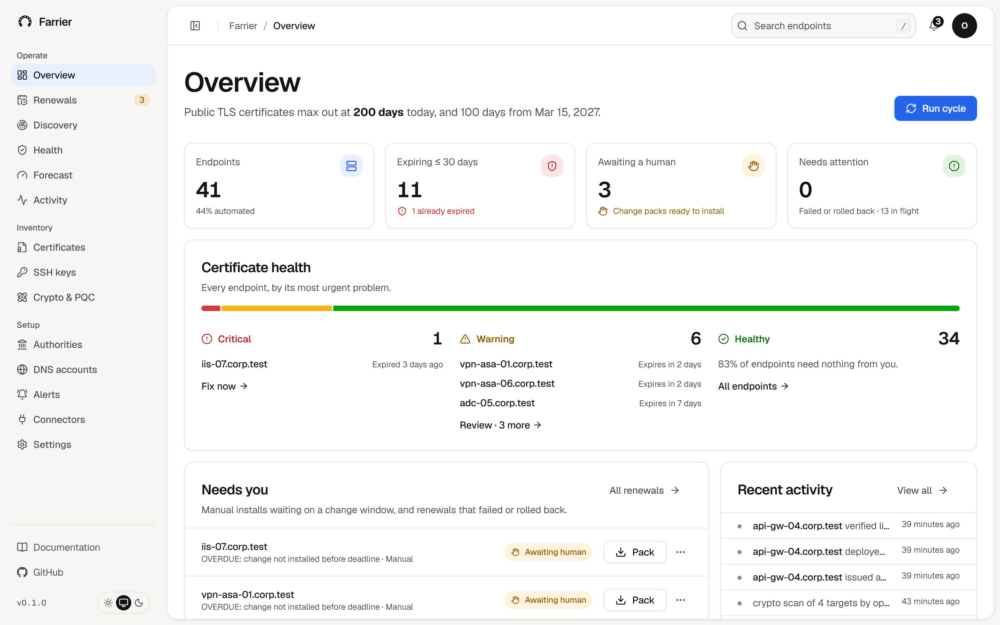

<div align="center">


# Farrier

**Agentless machine identity automation.**

Farrier discovers, manages and secures every machine identity across your infrastructure: TLS certificates,
SSH keys, cryptographic assets and post-quantum (PQC) readiness. Your team oversees; Farrier handles the rest.
No agents. No manual renewals. No missed expirations. Open source, self-hosted, no account.

[](https://github.com/gagankarthik/farrier/actions/workflows/ci.yml)
[](LICENSE)


[Website](https://farrier-erc1.vercel.app) · [Docs](https://farrier-erc1.vercel.app/docs) · [Install](https://farrier-erc1.vercel.app/docs/install/) · [Security](https://farrier-erc1.vercel.app/docs/security/)



</div>

## Why

Public TLS lifetimes are shrinking (CA/B Forum SC-081): **200 days** from 15 March 2026, **100** from 2027,
**47** from 2029. Cloud workloads already auto-renew. The pain is the long tail: load balancers, firewalls,
VPN concentrators, Java keystores and vendor appliances that need a ticket and a change window.

```
$ farrier forecast --certs 1000 --manual 0.4 --minutes 45
from         max life  renew every  per year  per work day  manual h/yr   FTE
2026-03-15       200d         133d      2744          11.0        823.5  0.51
2027-03-15       100d          67d      5448          21.8       1634.2  1.02
2029-03-15        47d          31d     11774          47.1       3532.5  2.21
```

## How it works

```
 scan ──▶ plan ──▶ issue ─────────▶ deploy ──────────────▶ verify
 what's    due date,  ACME DNS-01 on     F5 / FortiGate / PAN-OS /   the handshake shows the new
 served    window,    the device's       keystore / files over SSH   certificate, its chain and
           daily cap  behalf             ─ or ─ change pack + ticket  every name, or roll back
```

The device never talks to a CA. Every automated deploy installs the new certificate under a new name,
switches over and keeps the old one, so a failed check rolls back by itself.

## Features

| | |
|---|---|
| **Connectors** | F5 BIG-IP, FortiGate, Palo Alto PAN-OS, Citrix ADC, IIS (over OpenSSH), Kubernetes TLS Secrets, Java keystores, files over SSH. Everything else gets a change pack (PEM, PFX, runbook) and a ticket, and closes itself when the scanner sees the new certificate. |
| **Any CA** | Let's Encrypt, ZeroSSL, Google Trust Services, Buypass, SSL.com, DigiCert, Sectigo, AWS Certificate Manager over ACME (with External Account Binding), or the built-in private CA. |
| **29 DNS providers** | Cloudflare, Route 53, Azure DNS, Cloud DNS, RFC 2136 and more, several accounts each, with CNAME delegation. Records are verified on every authoritative nameserver and always cleaned up. |
| **Deployment verification** | Done only when the fingerprint, chain, names and every listed VIP check out. |
| **SSH keys** | Scans SSH hosts for host keys, key exchange, ciphers and MACs without logging in. With an access profile it reads `authorized_keys`, flags weak and unknown keys, and removes a key after showing a dry run. |
| **Crypto and PQC readiness** | Probes every TLS and SSH service for protocol versions, ciphers, key exchange and certificate keys. Each asset is ready, hybrid, vulnerable or unknown for post-quantum, with TLS 1.0/1.1, RSA under 2048 bits and SHA-1 flagged. Exports a CycloneDX CBOM. |
| **Tickets and events** | ServiceNow and Jira tickets that open with the change pack, update as the renewal moves and close when the new certificate is live. Events to Datadog and Splunk. |
| **Domain health and zombies** | An A–F grade per endpoint, and a scanner for expired, stale, unexpected and forgotten certificates. |
| **AI agents** | An MCP server for Claude, Gemini CLI, Codex and any MCP client. Read-only unless you allow writes. |
| **Zero downtime** | SQLite to start; your own PostgreSQL or MySQL and several replicas with leader election when it matters. |
| **Single sign-on** | OIDC with Okta, Entra ID, Google, Keycloak and others, with viewer, operator and admin roles. |
| **Observability** | Prometheus `/metrics`, CSV inventory export, Slack, Teams, webhook and email (SMTP, Amazon SES) alerts. |

## Quickstart

```bash
git clone https://github.com/gagankarthik/farrier.git && cd farrier
pip install -e .[dev]
farrier demo                     # 41 real TLS endpoints on localhost, API on :8740

cd web && npm install
FARRIER_API_URL=http://127.0.0.1:8740 npm run dev    # site, docs and dashboard on :3000
```

Without `FARRIER_API_URL` the web app runs against a simulated estate, so you can preview it with no backend.

## Install

Farrier is two containers and a database: **web** (the dashboard people open) talks to **engine** (API and
renewal loop, never exposed), which talks to your devices, CAs and DNS. Nothing is installed on devices.

| You want to | Use |
|---|---|
| See it work on your laptop | `farrier demo` (above) |
| Run it for one team on one server | `install.sh` (one command, below) |
| Run it in production on one server | `deploy/compose/production.yml` (PostgreSQL, object storage, file secrets) |
| Run it on your Kubernetes | `helm install farrier deploy/helm/farrier` |
| Run it on EKS, GKE or AKS | `deploy/terraform/{eks,gke,aks}` + `examples/values-{eks,gke,aks}.yaml` |
| Run it on AWS, Google Cloud or Azure without Kubernetes | `deploy/terraform/{aws,gcp,azure}` (ECS Fargate, Cloud Run, Container Apps) |
| Run it with no internet access | mirror the two images and use the built-in private CA |

Copy-paste steps for each, and how to grow from one server to many teams without reinstalling:
**[Install guide](https://farrier-erc1.vercel.app/docs/install/)**.

```bash
# any machine with Docker: writes a .env with a random token and password, pulls the images, starts both
curl -fsSL https://raw.githubusercontent.com/gagankarthik/farrier/main/install.sh | sh

# or try a simulated estate of 41 endpoints first
curl -fsSL https://raw.githubusercontent.com/gagankarthik/farrier/main/install.sh | FARRIER_MODE=demo sh
```

Images are multi-arch and signed with cosign: `ghcr.io/gagankarthik/farrier` and `farrier-web`.

## Security

- Private, ACME account and CA keys are encrypted at rest under your master key.
- Credentials are `env:` or `file:` references; inline secrets are refused.
- Read-only tokens, role-based sign-in, and every change logged with the person or agent who made it.
- Shell-command fields are refused over the API unless you opt in.

Report vulnerabilities privately through GitHub's security advisories. See the [security model](https://farrier-erc1.vercel.app/docs/security/).

## Status and verification

| What | How it is verified |
|---|---|
| Renewal engine: plan, issue, deploy, verify, roll back, backoff | 290+ engine tests, every commit |
| ACME (RFC 8555, EAB, ARI, profiles) | Pebble, Let's Encrypt's own ACME test server, every commit; Let's Encrypt staging and AWS ACM nightly ([live workflow](.github/workflows/live.yml)) |
| F5, FortiGate, PAN-OS, Citrix ADC, Kubernetes, IIS connectors | Contract tests against each vendor's documented management API |
| 29 DNS providers | Contract tests per provider API; the dashboard's **Test** button proves a live account end to end |
| AWS, Azure and Google integrations | Contract tests per API, plus `terraform validate` for every reference deployment |
| PostgreSQL, MySQL, SQLite | Schema migrations and leader election, every commit |

Before Farrier changes production, run the [pilot checklist](https://farrier-erc1.vercel.app/docs/pilot/) on one
low-risk endpoint per device type: every enterprise CLM rollout starts this way. Results from your devices
(model and OS version) are welcome as issues; confirmed versions are listed in the docs.

## Repository

```
farrier/   Python engine: api, core, db, security, config, monitoring, events, connectors, dns, issuers, storage
tests/     engine tests (python -m pytest)
web/       Next.js dashboard: what teams install (Docker image farrier-web; the public demo is web/ with no engine)
site/      Next.js public website: landing page and docs, a static export (hosted on Vercel)
deploy/    Terraform (AWS, GCP, Azure), Helm, Compose, Kubernetes   examples/   configs for issuers, DNS, MCP
events/    the CloudEvents contract       functions/  Lambda, Cloud Functions and Azure Functions that react to it
```

## Contributing

Issues and pull requests are welcome. Run `python -m pytest` for the engine, and `npm run lint && npm run build`
in `web/` (and in `site/` for docs changes). See the [contributing guide](https://farrier-erc1.vercel.app/docs/contributing/).

## License

[MIT](LICENSE)
